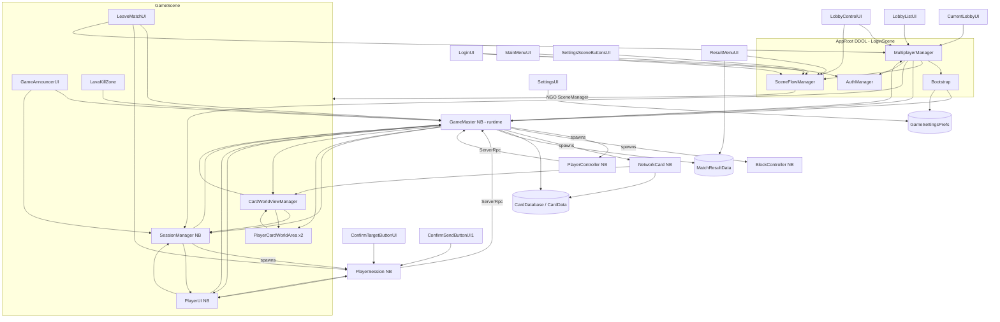

# Class Dependencies and Regression Points

- **Updated:** 2026-10-24 (Codex's TASK-N27 and TASK-F9_F14a_N62; header refresh and structure pass in Issue Report #16). Full refresh: 2026-10-20 (TASK-N8). First audit: 2026-10-18. Each task since then updated the sections it touched.
- **Code baseline:** commit `5abd155`, reviewed in [Issue Report #16](../Reports/2026-10-24_IssueReport-16.md) §2. The owner's checklist #16 for N27 / F9 / F14a / N62 is pending.
- **Method:** static reading. Every edge below was found as a real call, field access or event subscription in code, not inferred from names.
- Tags are defined in [Architecture.md](Architecture.md).

**Sources:** all files in `Assets/Scripts/**`. Scene and prefab wiring comes from `Assets/Scenes/*.unity` and `Assets/Prefab/**/*.prefab`, matched by script GUID from the `.cs.meta` files.

---

## 1. Script → asset placement [Confirmed by GUID search]

| Script | Used in |
|---|---|
| `Bootstrap`, `AuthManager`, `SceneFlowManager`, `MultiplayerManager` | `LoginScene` / `AppRoot` (one GameObject, DDOL). Old copies of `Bootstrap` and `MultiplayerManager` also sit in `BootsTrap.prefab` and `MultiplayerManager.prefab`; no scene uses those prefabs. |
| `LoginUI` | `LoginScene` |
| `MainMenuUI` | `MainMenuScene` |
| `SettingsUI`, `SettingsSceneButtonsUI`, `DisplaySettingsUI` | `SettingsScene` |
| `LobbyControlUI`, `LobbyListUI`, `LobbyPlayerListUI`, `CurrentLobbyUI` | `LobbyScene` |
| `LobbyListItemUI`, `LobbyPlayerItemUI` | `UiPrefab/LobbyListItemPrefab`, `LobbyPlayerItemPrefab` |
| `SessionManager` | `SessionManager.prefab` → in-scene instance in `GameScene` |
| `PlayerUI`, `ConfirmTargetButtonUI`, `ConfirmSendButton` (class `ConfirmSendButtonUI1`), `LeaveMatchUI` | `UiPrefab/PlayerUIPrefab` → in-scene instance in `GameScene` |
| `ResolutionProfileLayout` / `UiResolutionProfile` | Gameplay HUD plus five menu canvases, LobbyListItemPrefab and LobbyPlayerItemPrefab's role label; local rectangle/font profiles and static width threshold |
| `NoticeUI` / `PlayerNotice` | LoginScene and LobbyScene NoticePanel / static time-windowed notice store |
| `CardWorldViewManager` | `CardWorldManagerPrefab` → `GameScene` |
| `PlayerCardWorldArea` (file `PlayerCardfWorldArea.cs`) | `PlayerWorldCardAreaPrefab` ×2 in `GameScene` (`m_sessionSearchId` 0 and 1) |
| `SpawnPoint` | `SpawnPoint.prefab`: ×2 in `GameScene` (`m_teamId` 0 and 1), and as a child of `BlockBody` |
| `GameAnnouncerUI`, `LavaKillZone` | `GameScene` |
| `ResultMenuUI`, `ResultSceneController` | `ResultScene` |
| `GameMaster` | `GameMasterPrefab` (spawned at runtime) |
| `PlayerSession`, `CardPreviewController` | `PlayerSessionPrefab` |
| `PlayerController`, `PonyColorScript` | `BoardPrefab/PonyBase` |
| `BlockController` | `BoardPrefab/BlockBody` |
| `NetworkCard` | `CardPrefab` |
| `CardViewUI` / `CardViewWorld` | `CardViewUIPrefab` / `BoardPrefab/CardWorldViewPrefab` |
| Not components (plain classes, structs, ScriptableObjects, static helpers) | `CardData`, `CardDataBase`, `CardViewBase`, `CardControllPackage`, `PlayerControlPackage`, `PlayerTurnSelection`, `GameSlot`, `MatchResultData`, `SuspiciousActivityLog`, `GameSettingsPrefs`, `DebugModeGuard` |

Every component script is used by at least one enabled scene or prefab.

The NetworkManager uses `Prefab/NetworkPrefabs.asset`: GameMaster, PonyBase, BlockBody, CardPrefab, SessionManager, SpawnPoint and PlayerSession. The extra GUID `e651dbb3…` is NGO's own `NetworkPrefabsList` script (U5, closed).

---

## 2. Dependency graph (runtime calls)

### 2.1 Edge list with evidence

| From → To | Calls / accesses | Where |
|---|---|---|
| `MultiplayerManager` → `Bootstrap` | `RecreateNetworkManager`, `RecreateGameMaster`, `m_gameMasterInstance` | `Start`, `StartHost`, `JoinLobbyById`, `OnLoadEventCompleted` |
| `MultiplayerManager` → `GameMaster` | `ClearupAfterDisconnect`, `SpawnPlayers`, `StartNewGame`, `AbortMatch` | disconnect and result paths, `StartGameAfterSceneReady`, `AbortGameStart` |
| `MultiplayerManager` → `SessionManager` | `Instance.m_playerSessions.Count`, `ClearSessionOnDisconnect` | `StartGameAfterSceneReady`, `CleanupAfterDisconnect`, `LeaveMatchToResultScene` |
| `MultiplayerManager` → `SceneFlowManager` | `LoadGameSceneNetwork`, `MarkNetworkSceneLoadingFinished`, `LoadLobbyScene`, `LoadResultScene`, `GameSceneName` | `StartGameSceneWhenReady`, `OnLoadEventCompleted`, `CleanupAfterDisconnect`, `LeaveMatchToResultScene` |
| `MultiplayerManager` → `AuthManager` | `Initialize` | `Start` |
| `GameMaster` → `MultiplayerManager` | writes `m_currentMultiplayerStatus`; `Disconnect`; `LeaveMatchToResultScene` | `SpawnPlayers`, `AbortMatch`, `MatchEndedClientRpc` (**two-way coupling**) |
| `GameMaster` → `MatchResultData` | `Set(isWinner, isDraw, reason)` | `MatchEndedClientRpc` (every peer) |
| `GameMaster` → `SessionManager` | `Instance.m_playerSessions`, `GetPlayerSession` | `StartNewGame`, `ClearupAfterDisconnect`, `Spawn*`, `InputQueueUpdate`, `FindSessionForCardWorldArea`, suspicious-sender lookups |
| `GameMaster` → `PlayerUI` / `CardWorldViewManager` | `ClearLocalUI`, `OnCardDataReceived`; `ClearAllWorldViews`, `RefreshAllSessions` | `ClearupAfterDisconnect`, `SendCardDataClientRpc` (**server rules → client UI**) |
| `GameMaster` → `PlayerSession` | the three NetworkLists, `m_lifeCurrent`, `m_manaCapacity/m_manaCurrent`, `TeamId`, `GetCharacter/SetCharacter`, `SetSpawnPoint`, `AddBlock/DeleteBlock`, `ClearSession`, `ClearSelectedCard`, `SetOponent`, `AddCard`, `ReportSuspicious`, `GetSuspiciousLog`, `SelectionRejectedClientRpc`, `HandLimitDiscardClientRpc` | throughout |
| `GameMaster` → `PlayerController` | `m_hpCurrent/m_hpMax`, `GetRigidbody`, `Initialize`, `SessionObjectId`, `GetSession` | `Processing.cs`, `Spawn.cs` |
| `GameMaster` → `BlockController` | `m_blockHP`, `m_teamId`, `GetSpawn`, `GetSession`, `GetMaxHP`, `Initialize` | `Processing.cs`, `Spawn.cs`, `GameLoop.cs`, `PackageManaging.cs` |
| `GameMaster` → `NetworkCard` | `m_cardData`, `m_ownerId`, `SetOwner`, `SetLocation`, `m_isRotated`, `m_isFaceUp`, `RepairCardData` | `Card.cs`, `PackageManaging.cs` |
| `GameMaster` / `PlayerSession` → `CardTargetRules` | `RequiresSelectedTarget` | `PlayerActionPhase` and client `CheckPackage` share one rule (N20) |
| `SessionManager` → `GameMaster` | `HandlePlayerLeft` | `OnClientDisconnected` (server) |
| `SessionManager` → `PlayerUI` | `ClearLocalUI`, only when the local client disconnected (N17) | `OnClientDisconnected` |
| `PlayerSession` → `GameMaster` | `CanPlayerSelectCards/CardTargets`, `m_gamePhase`, `IsWaitingRespawnPlayer`, `GetSessionByID`, `HandleConfirmTurn`, `HandleCardControlPackage`, `HandlePlayerSurrender` | `PlayerSession.cs` |
| `PlayerSession` → `PlayerUI` | `OnSelectionRejected`, `ShowHandLimitDiscard` | owner-only client RPCs |
| `PlayerSession` → `SessionManager` | sets `LocalPlayer`; `GetPlayerSession` for sender checks | `RegisterLocalPlayerWhenReady`, `LeaveMatchServerRpc` |
| `PlayerSession` → `CardPreviewController` | `ShowPreview/HidePreview` | `SelectObject` |
| `CardPreviewController` → `PlayerUI` / `Canvas` / `LayoutRebuilder` (UI4/UI6, N50, F9) | Resolve missing HUD canvas/root and `CardViewDock` on demand; fit/refit the preview in the dock, otherwise use the pointer/clamp fallback | `ShowPreview`, `TryResolveTargets`, `LateUpdate`; `HidePreview()` fades, `HidePreview(true)` clears both slots for cleanup; live assigned references preserved; destroyed scene targets re-resolved |
| `PlayerUI` → local `PlayerSession.CardPreviewController` / `CardViewUI` | Cache the local controller; subscribe to hand pointer enter/exit; preserve matching previews through clicks and clean up removed cards | `CreateCardView`, hover handlers, `UpdateCards`, `ClearHandUI`, `ClearLocalUI` |
| `PlayerController` → `GameMaster` | `CanPlayerMove`, `HandlePlayerControlPackage` | `SendMovementInput`, `InputServerRpc` |
| `PlayerController` → `PonyColorScript` | `SetMaterials`, `SetSelected` | `ApplyMaterial`, `SetSelected` |
| `BlockController` ↔ `PlayerSession` | `SetSession/GetSession`; the session holds a `BlockController[5,5]` | **server-only references** (not networked) |
| `NetworkCard` → `GameMaster` / `CardWorldViewManager` | `GetCardDatabase` → `TryGetCard`; `RefreshAllSessions` on every NetworkVariable change | `RepairCardData` (keeps the old data on a failed lookup, M14); `On*Changed` |
| `PlayerUI` → `SessionManager` / `GameMaster` / `PlayerSession` | `LocalPlayer`; `m_gamePhase` and `m_selectionPhaseId` subscriptions; NetworkList subscriptions; `GetHandCards/GetBoardPlayCards`; `SelectCardToPlay/Discard`; `ClearLocalCardSelection`; `PruneLocalCardSelection`; `IsCardSelectedToPlay/Discard`; `ConfirmTurn`; `GetSessionByID` (opponent mana) | `PlayerUI.cs` |
| `LeaveMatchUI` → `GameMaster`, `SessionManager`, `PlayerSession`, `MultiplayerManager` | polls the phase; `LocalPlayer.RequestLeaveMatch`; falls back to `Disconnect` | `PlayerUIPrefab/LeaveMatch` |
| `CardViewUI` / `CardViewWorld` → `CardViewBase` | `m_textData`, `ApplyTexts` on `SelectedLocaleChanged` (L7) | `CardViewBase.OnEnable/OnDisable` |
| `CardWorldViewManager` → `SessionManager` / `GameMaster` / `PlayerCardWorldArea` | `m_playerSessions`; `GetPlayerCardWorldArea`; `Initialize/GetCardLocalPosition` | `CardWorldViewManager.cs` |
| `PlayerCardWorldArea` → `CardWorldViewManager` | `RegisterArea` | `Initialize` (**mutual**) |
| `GameAnnouncerUI` → `GameMaster` / `SessionManager` | `m_gamePhase`, `GetPhaseSecondsLeft`, `m_activePlayer`, `m_waitingRespawnPlayer`; `LocalPlayer` | `UpdateAnnounceText` |
| `LavaKillZone` → `GameMaster` | `ServerKillPlayerByHazard` | `TryKillPlayer` |
| `LobbyControlUI` → `MultiplayerManager` / `SceneFlowManager` | `StartHost`, `LobbyConnected`, `Disconnect`; `LoadMainMenuScene` | buttons and `RefreshUI` |
| `LobbyListUI` → `MultiplayerManager` | `FindAvailableLobbies`, `JoinLobbyById` | `OnClickRefreshLobbyList`, `OnJoinLobbyClicked` |
| `CurrentLobbyUI` → `MultiplayerManager` | `RefreshCurrentLobby`, `GetCurrentLobby`, `CanStartTwoPlayerGame`, `StartGameScene` | `RefreshLobbyLoop`, `OnClickStartGame` |
| `LoginUI` → `AuthManager`, `SceneFlowManager`. `MainMenuUI` / `SettingsSceneButtonsUI` / `ResultMenuUI` → `SceneFlowManager` | sign-in, scene loads | UI scripts |
| `SettingsUI` / `Bootstrap` → `GameSettingsPrefs` | `LanguageCode` write / read | `OnLanguageChanged`, `ApplySavedLanguage` |
| `ResultMenuUI` → `MatchResultData` | `HasResult`, `IsWinner`, `IsDraw`, `Reason`, `Clear` | `Start`, `OnClickMainMenu` |

### 2.2 Data and event contracts (network)

| Contract | Writer | Readers |
|---|---|---|
| `GameMaster.m_gamePhase` | server `GameLoop` and its helpers | `PlayerUI` (OnValueChanged), `GameAnnouncerUI`, `LeaveMatchUI`, `PlayerSession` (poll), `GameMaster.Can*` |
| `GameMaster.m_phaseEndServerTime` (L1) | server, at phase start, a selection reset and resume; cleared on end, abort and new game | `GameMaster.GetPhaseSecondsLeft` → `GameAnnouncerUI` |
| `GameMaster.m_isInputLocked` (N3) | server `Update`, only on a change; reset on cleanup and new game | clients' movement, selection and target gates. The server uses its own flags. |
| `GameMaster.m_selectionPhaseId` (N26) | server, +1 at each `CardSelectionPhase` start; 0 on new game; unchanged by a respawn pause | local `PlayerUI` clears both selection lists and rebuilds |
| `GameMaster.m_activePlayer` / `m_waitingRespawnPlayer` (`NetworkBehaviourReference`) | server | `GameAnnouncerUI`, `GameMaster.Can*`, `IsWaitingRespawnPlayer` |
| `GameMaster.MatchEndedClientRpc(winnerClientId, reason)` | server `EndMatch` | every peer → `MatchResultData`, `LeaveMatchToResultScene` |
| `GameMaster.SendCardDataClientRpc(cardId)` | server: to the owner on a draw, to everyone on board placement | `NetworkCard.RepairCardData`, `CardWorldViewManager`, `PlayerUI.OnCardDataReceived` |
| `PlayerSession.m_handCards/m_boardPlayCards/m_boardDiscardCards` | server | `PlayerUI` (local session), `CardWorldViewManager` (every session's board), `GameMaster` |
| `PlayerSession.TeamId/ClientId/CharacterObjectId/m_lifeCurrent/m_currentOponentNetworkObjectId` | server; `ClientId`, `TeamId` and lives are first written in server `OnNetworkSpawn` (N2) | UI, `GameMaster`, `CardWorldViewManager`, card-area binding |
| `PlayerSession.m_manaCapacity/m_manaCurrent` | server `StartNewGame`, `ApplyRoundManaGrowth`, `AddMana` | everyone; local play selection checks current mana; `PlayerUI` shows own and opponent mana |
| `PlayerSession.SelectionRejectedClientRpc`, `HandLimitDiscardClientRpc` | server, sent to the owner only | owner: clears the selection / shows a 2 s message |
| `PlayerSession.ConfirmTurnServerRpc(intendedPhase, …)` (N21), `CardInputServerRpc`, `LeaveMatchServerRpc` | owner client | server `GameMaster` handlers |
| `SessionManager.SessionDataList` (`NetworkList<SessionData>`) | server | all peers → `RebuildDictionary` → `m_playerSessions` |
| `NetworkCard.m_ownerId/m_location/m_isRotated/m_isFaceUp` | server | `CardWorldViewManager`, `CardViewWorld` |
| `NetworkCard.m_cardData` | **a plain server field + `SendCardDataClientRpc` per client** | every view, `GameMaster`, `PlayerSession` |
| `PlayerController.m_hpCurrent/m_hpMax/m_moveSpeedCurrent/m_playerTeam/SessionObjectId` | server; HP and speed in server `OnNetworkSpawn` (N22) | `PlayerUI`, `PonyColorScript` via `PlayerController` |
| `PlayerController.InputServerRpc(PlayerControlPackage)` | owner client | server: sender check, `ClientId` overwritten, queued |
| `BlockController.m_teamId/m_blockHP` | server | `PlayerSession` (targeting and respawn checks), `GameMaster`. L4 removed the duplicate `TeamId` variable. |

**Same build on both peers.** These tasks changed the NetworkVariable layout or the RPC table:
- N3, N26 and L1 added `GameMaster` NetworkVariables.
- N21 changed the confirm RPC.
- L10 removed `SendToClientRpc`.
- F1 adds `MatchAbortedClientRpc` and `DeckRefilledClientRpc`; F6 appends `MatchEndReason.BlocksDestroyed`.

Peers on different builds won't work together.

`BlockController.m_ownerSession` and `PlayerSession.m_blocks` are server-only. Clients find a block's owner by team instead (`PlayerSession.GetBlockOwnerSession`, M8), and find a block's spawn point through `BlockController.GetSpawn`, which falls back to the child component.

---

## 3. Object lifecycle

| Object | Created | Destroyed / reset | Notes |
|---|---|---|---|
| `AppRoot` | `LoginScene` load | Never (DDOL). Duplicates self-destroy on a Login reload. | [Confirmed] |
| `NetworkManager` | `Bootstrap.RecreateNetworkManager` at app start, and again before every host/join | `Shutdown()`, then `Destroy(old)` | `MultiplayerManager.SubscribeNetworkEvents` redoes its subscriptions. `PlayerUI.OnEnable` and `SessionManager.OnNetworkSpawn` bind to the instance that exists when they enable or spawn. |
| `GameMaster` | Server, after the GameScene load event, through `RecreateGameMaster` (despawn old, spawn new) | Despawn, or scene unload on shutdown | `Instance` is set in `OnNetworkSpawn` and cleared in `OnNetworkDespawn` |
| `SessionManager` | In-scene NetworkObject in `GameScene` | Scene unload | `Awake` sets `Instance`; `OnDestroy` clears it only if it still points to this object (M16). Despawn always removes the list callback. |
| `PlayerSession` | `SessionManager.CreateSession` per client | `SessionManager.OnClientDisconnected` (despawn) or `ClearSessionOnDisconnect` (server) | `LocalPlayer` is set by the owner's coroutine. `GameMaster.HandlePlayerLeft` removes a leaving session from `m_players` during a match. |
| Character / blocks | `GameMaster.SpawnPlayers` / `RespawnCharacter` | Death (`DespawnCharacter`), block HP 0, `ClearSessionOnDisconnect` (character) | Client-owned with `DontDestroyWithOwner: 0`, so NGO destroys them when the owner disconnects (U4) |
| Cards (84 per deck with today's database) | `CreateDeck` at `StartNewGame`, and server `RefillDeck` when the deck is empty | Graveyard cards: `RefillDeck` despawns and untracks them before building the new deck. Others: `DespawnAllCards`. | Hand and board cards survive refills. `NetworkCard.ClearView` on despawn destroys the UI and world views. |
| `PlayerUI` | In-scene NB in `GameScene` | Scene unload | Binds lazily in `Update`. Subscribes to `NetworkManager` callbacks in `OnEnable`. `OnDestroy` clears only its own singleton reference and its `GameMaster` subscriptions (N1). |
| `CardWorldViewManager` | `GameScene` | Scene unload (`OnDestroy` → unsubscribe, clear views) | Drops departed or destroyed sessions in `Update`; re-registers when the session count changes (L6) |
| `MatchResultData` | `Set` in `MatchEndedClientRpc` | `Clear` in `ResultMenuUI.OnClickMainMenu` | Static; survives the scene change to `ResultScene` |

---

## 4. Coupling hot spots

1. **`GameMaster`** (8 partial files, about 3.4k lines) owns rules, input queues, deck, spawning, card-area binding, RPC handlers, match end and disconnect cleanup. It also calls client UI (`PlayerUI`, `CardWorldViewManager`) and writes `MultiplayerManager` state.
2. **`PlayerSession`** (about 1.2k lines) mixes networked state (lists, lives, mana, team), server-only data (block grid, spawn point, suspicious-activity log), owner-only input (mouse raycast, targeting, card selection) and the preview UI.
3. **`MultiplayerManager`** (about 1.6k lines) handles lobby, relay, start, result exit and disconnect. These async paths share flags (`m_onDisconnecting`, `m_isLeavingToResult`, `m_isRelayAction`, `m_isStartingGameScene`).
4. **Static singletons everywhere.** There are no interfaces or events between subsystems. UI finds managers by polling `Instance`.
5. **Card identity outside the network model.** `NetworkCard.m_cardData` is a plain field, set on the server and pushed by RPC. Client code sees `null` until the RPC arrives. N20/M14 guard package checks, confirmation, targeting and click logs.
6. **Team identity as an integer** shared by `SpawnPoint.m_teamId`, `PlayerCardWorldArea.m_sessionSearchId`, `PlayerSession.TeamId`, `BlockController.m_teamId`, `PlayerController.m_playerTeam` and the material index in `PonyColorScript`. `GameAnnouncerUI` maps 0 → red and 1 → blue. Slots 2 and 3 exist in `SessionManager.GetFreeSlot`, but the scene has nothing for them.

---

## 5. Packages and assets

Direct dependencies (`Packages/manifest.json`):

| Package | Version | Used for |
|---|---|---|
| `com.unity.netcode.gameobjects` | 2.11.2 | All networking |
| `com.unity.services.multiplayer` | 2.2.2 | Lobby and Relay (resolves `com.unity.transport` 2.7.2) |
| `com.unity.services.authentication` | 3.6.1 | Anonymous sign-in |
| `com.unity.localization` | 1.5.11 | Tables `UI_table`, `Cards`; locales en/ru/ja |
| `com.unity.inputsystem` | 1.19.0 | Keyboard and mouse |
| `com.unity.render-pipelines.universal` | 17.3.0 | Rendering |
| `com.unity.ugui` | 2.0.0 | uGUI and TextMeshPro |
| `com.unity.test-framework` | 1.6.0 | Not used by any test in the repo yet |

- **VisualScripting was removed** by L10. Its only use was `ConvertTo<int>()` in the heal branch, now `System.Convert.ToInt32`: same rounding, checked by Codex for 7 values.
- **Localization assets** (`Assets/Localization/`): `UI_table` (86 keys) and `Cards` (8 keys), each with en/ru/ja tables, plus the three locales and `Localization Settings.asset`.
- **Font asset:** `Assets/Fonts/MPLUSRounded1c-Medium SDF.asset` is a dynamic TMP font that every TMP text uses.
  - Its source font stays referenced, and "Clear Dynamic Data On Build" is on (N28).
  - Editor runs add glyphs to it. Per `AGENTS.md`, restore it before committing unless the task changes the font settings.
- **ParrelSync** is under `Assets/ParrelSync-master/ParrelSync-master/ParrelSync/` (Editor-only assembly `projectCloner`). The clone `C:/Lesson/FallenStar-Spellcasters_clone_1` shares `Assets` through a symlink, so it sees uncommitted changes immediately.

---

## 6. Regression points

Each item is a place where a change is likely to break another system. These are not fixes.

| # | Area | Why fragile | Check after any change |
|---|---|---|---|
| RP1 | `GamePhase` enum | Sent as an int in a NetworkVariable. Used by `PlayerUI`, `GameAnnouncerUI` (its `switch` **throws** on unknown values), `HandleConfirmTurn` / `IsConfirmForCurrentPhase`, `LeaveMatchUI`, `Can*`, and the `Phase.*` keys | Append values only. Update the announcer switch and add keys in en/ru/ja. DrawCards is now assigned while dealing (F4). |
| RP2 | `HandleConfirmTurn` multiplexing | One RPC means "confirm selection", "end turn" or "confirm respawn". N21 tags it with the intended phase and drops mismatches. | A confirm sent just before a phase change is dropped; the player presses again |
| RP3 | `CardControllPackage` with 4 fixed targets | `MaxTargets = 4`; `CreateEmpty` makes 4 slots. The reader rejects counts outside 0–4 without reading targets; the server handler rejects null, empty or oversized lists. The loop requires slots ≥ activities, and `CardData.OnValidate` keeps exactly 4 activities. | Changing the activity count must also change `MaxTargets` and validation (N58 / GL5) |
| RP4 | `SendCardDataClientRpc` → `RefreshAllSessions` / `OnCardDataReceived` | Every reveal rebuilds all world views; missing local views rebuild the hand | Data/list ordering, selection colours |
| RP5 | `MultiplayerManager` ↔ `NetworkManager` recreation | Subscriptions must be redone for every new NetworkManager. Other classes subscribe on their own. | Host → leave → host again; join → leave → join |
| RP6 | Disconnect and result chains | `HandleLostConnectionToHost`, `Disconnect`, `LeaveMatchToResultScene` and `CleanupAfterDisconnect` share flags and call `ClearupAfterDisconnect` / `ClearSessionOnDisconnect` around `Shutdown()`. N61 ignores only the host's own shutdown tail after cleanup; `ShouldShowConnectionLost` selects client lobby/match losses and excludes cancellations. | Client leave, host leave, forfeit in each phase, connection loss, app quit |
| RP7 | `SessionManager.GetFreeSlot` → `TeamId` | Team is the slot index; the scene supports teams 0 and 1 only | Reconnect order, a third connection |
| RP8 | Scene names and IDs | `SceneFlowManager` uses scene-name strings; areas and spawn points are matched by integer team ID | Renaming scenes, duplicating areas or spawn points |
| RP9 | `ConfirmSendButton.cs` / class `ConfirmSendButtonUI1` | File and class names differ, and `PlayerUIPrefab` references the script. It works today (C6). | Renaming either breaks the cast button. Report, don't rename. |
| RP10 | Nested NetworkObjects | `SpawnPoint.prefab` (NetworkObject) is a child of `BlockBody` (NetworkObject). The N27 mane child has no NetworkObject, Collider, Rigidbody or Animator. | NGO nested-object warnings or spawn errors (U2); keep the mane free of network/physics components |
| RP11 | Server authority (M4) | `GameMaster.Update` and `HandlePlayerControlPackage` require `IsServer`; lobby-host checks stay in `MultiplayerManager` | Host/client movement; a dedicated server is untested |
| RP12 | NetworkVariable layout and RPC table | Adding or removing NetworkVariables or RPCs on a NetworkBehaviour changes what peers expect | Both peers on the same build (§2.2); F1 adds MatchAbortedClientRpc and DeckRefilledClientRpc, F6 appends BlocksDestroyed |
| RP13 | Lobby request rate | Lobby calls are rate-limited per player. `RefreshCurrentLobby` throttles `GetLobbyAsync` to one request at a time, 1.5 s apart (N30). | Any new `GetLobbyAsync` caller must go through `RefreshCurrentLobby` |
| RP14 | Debug flags (L9) | Release builds rely on `DebugModeGuard.Allow` as the first statement in `Awake` | A new class with a `m_debugMode` flag must call it too |
| RP15 | Change-only UI (L6 / N35) | `GameAnnouncerUI`, `PlayerUI` HP/lives/mana labels and `LobbyControlUI` skip work when their cached state is unchanged; health caches invalidate on locale, enable and local cleanup | A new displayed value or alive/dead state must be included in cache invalidation |
| RP16 | Dynamic font asset (N28) | Any Editor run with new text changes the asset | Restore it before committing |
| RP17 | Identifier typos (per `AGENTS.md`: report, don't rename) | `CardControllPackage`, `PlayerCardfWorldArea.cs`, `SetOponent` / `m_currentOponentNetworkObjectId`, `CheckActiveTaergetSelection`, `SingInAnonymous` / `SingOut` / `m_isSingingIn`, `HearthbeatLobby`, `MovePlayeToSpawnPoint`, `ClearupAfterDisconnect`, `DeffenceSpell`, `m_bootsTrap`, `_teamAssing`, `m_phaseAnouncementText`, `#region Valiable`, `ConfirmSendButtonUI1`, `m_startHandCards` (really the per-round draw count) | Any rename breaks serialized references, `nameof(HearthbeatLobby)` in `InvokeRepeating`, and the public API |
| RP18 | World-space canvases on board objects (N54) | `PlayerSession.Update` treats any UI hit as a HUD click and skips its board raycast | Keep board canvases free of `GraphicRaycaster` components and raycast-target graphics; the screen-space HUD must still block clicks |
| RP19 | Out-of-match notices (N59/F1) | PlayerNotice is a static store with a posting time and duration, not a consumed message | Scenes that display these notices need NoticeUI; keep its component active and toggle only the child Box |
| RP20 | Timed phases (N36) | Loop completion and clients share the replicated deadline | StartPhaseCountdown at phase start; loop on PhaseTimeLeft; save remaining seconds across pauses |
| RP21 | Menu/HUD layouts (UI7, F14a) | Five menu canvases and both lobby item prefabs apply local low rectangles; LowText overrides fonts. Approved notice heights are 104 in both profiles; role width restores 150 low → 140 authored. HUD backing boxes follow text bounds and transforms without profile entries. | New menu elements need a low rectangle or must fit as authored; text that autosizes below 24 needs LowText. New HUD text needing a box gets a non-raycasting HudTextBacking sibling immediately before it. |
| RP22 | Mane colour pool and model import (N27) | `ManeColor` ordinal equals the index into `PonyColorScript.m_maneMaterials`; `NetworkManeColor` replicates it | Append enum values only and keep material order aligned. PonyMane/PonyBase Model scale/unit/axis settings must agree; PonyMane preserves its root hierarchy. |

---

## 7. Unknowns requiring separate verification

1. NGO behaviour with the nested `SpawnPoint` NetworkObject (RP10, U2). No warning in any log so far.
2. The NGO `NetworkSceneManager.Dispose` NRE on Play Mode stop, Editor quit or domain reload (U9). It happens inside NGO during teardown and is probably harmless.
3. Real two-peer disconnect regression checks remain manual. N61's host-only fixture measured two LobbyScene loads before the guard and one after it; actual connected-client timing still needs the owner's check.

## History

Resolved since the first audit:
- **Standalone build** (formerly RP11): runtime `UnityEditor` / `NUnit` imports were removed (C5), and player builds succeed (U1).
- **`ConfirmSendButtonUI1` loading** (formerly RP10): works (C6, report #5).
- **Unresolved network-prefab GUID:** U5, closed.
- **Null `NetworkBehaviourReference` and `DontDestroyWithOwner`:** answered (U3, U4).
- **Pure-client reads of server-only block owners:** M8 matches by team instead.
- **`CardData.OnValidate`** used to overwrite activities 1–3; it now only keeps the array at 4.
- **Duplicate `BlockController.TeamId`:** removed by L4. It also caused an Inspector `ArgumentException`.
- **Legacy wiring:** `DisconnectMenuUI`, `SpawnPanelUI`, `DisconnectButtonUI`, `LocalizedTMPFormat`, the echo RPC and the legacy scenes are deleted (L10), so their edges are gone.
- **Polling cost** (formerly RP14):
  - the announcer and HUD now skip unchanged frames (L6)
  - departed sessions no longer trigger scene searches (L6)
