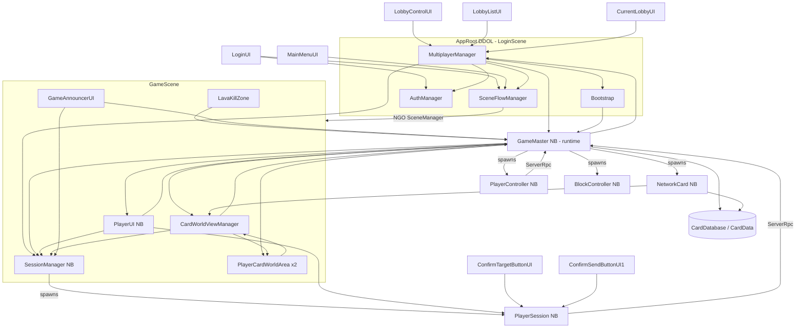

# Class Dependencies and Regression Points

- **Audit date:** 2026-10-18
- **Baseline:** commit `1f6d2f1` plus the uncommitted working tree
- **Method:** static reading. Every edge below was found as a real call, field access or event subscription in code. Edges were not inferred from names.
- Tags are defined in [Architecture.md](Architecture.md).

**Sources:** all files in `Assets/Scripts/**`. Scene and prefab wiring comes from `Assets/Scenes/*.unity` and `Assets/Prefab/**/*.prefab`, matched by script GUID from the `.cs.meta` files.

---

## 1. Script → asset placement [Confirmed by GUID search]

| Script | Used in |
|---|---|
| `Bootstrap`, `AuthManager`, `SceneFlowManager`, `MultiplayerManager` | `LoginScene` / `AppRoot` (same GameObject, DDOL). Legacy copies also exist in `SampleScene`, `MultiplayerScene`, `BootsTrap.prefab`, `MultiplayerManager.prefab` |
| `LoginUI` | `LoginScene` |
| `MainMenuUI` | `MainMenuScene` |
| `SettingsUI`, `SettingsSceneButtonsUI` (M12) | `SettingsScene`; dropdown reference, localized labels and Back binding assigned |
| `LobbyControlUI`, `LobbyListUI`, `LobbyPlayerListUI`, `CurrentLobbyUI` | `LobbyScene` |
| `LobbyListItemUI`, `LobbyPlayerItemUI` | `UiPrefab/LobbyListItemPrefab`, `LobbyPlayerItemPrefab` |
| `SessionManager` | `SessionManager.prefab` → in-scene instance in `GameScene` |
| `PlayerUI`, `ConfirmTargetButtonUI`, `ConfirmSendButton` (class `ConfirmSendButtonUI1`), `LeaveMatchUI` (N19) | `UiPrefab/PlayerUIPrefab` → in-scene instance in `GameScene` |
| `CardWorldViewManager` | `CardWorldManagerPrefab` → `GameScene` |
| `PlayerCardWorldArea` (file `PlayerCardfWorldArea.cs`) | `PlayerWorldCardAreaPrefab` ×2 in `GameScene` (`m_sessionSearchId` 0 and 1) |
| `SpawnPoint` | `SpawnPoint.prefab`: ×2 in `GameScene` (`m_teamId` 0 and 1), and as a child of `BlockBody` |
| `GameAnnouncerUI`, `LavaKillZone` | `GameScene` |
| `GameMaster` | `GameMasterPrefab` (runtime spawn) |
| `PlayerSession`, `CardPreviewController` | `PlayerSessionPrefab` |
| `PlayerController`, `PonyColorScript` | `BoardPrefab/PonyBase` |
| `BlockController` | `BoardPrefab/BlockBody` |
| `NetworkCard` | `CardPrefab` |
| `CardViewUI` / `CardViewWorld` | `CardViewUIPrefab` / `BoardPrefab/CardWorldViewPrefab` |
| **Not referenced anywhere** | `DisconnectButtonUI`, `LocalizedTMPFormat`. `DisconnectMenuUI` and `SpawnPanelUI` appear only in the disabled legacy scenes. |

The NetworkManager uses `Prefab/NetworkPrefabs.asset`, which contains GameMaster, PonyBase, BlockBody, CardPrefab, SessionManager, SpawnPoint and PlayerSession, plus one GUID `e651dbb3…` that was not resolved inside `Assets`. **[Unknown]**

---

## 2. Dependency graph (runtime calls)

### 2.1 Edge list with evidence

| From → To | Calls / accesses | Where |
|---|---|---|
| `MultiplayerManager` → `Bootstrap` | `RecreateNetworkManager`, `RecreateGameMaster`, `m_gameMasterInstance` | `Start`, `StartHost`, `JoinLobbyById`, `JoinLobbyByJoinCode`, `OnLoadEventCompleted` |
| `MultiplayerManager` → `GameMaster` | `ClearupAfterDisconnect`, `SpawnPlayers`, `StartNewGame`, `AbortMatch` | Existing cleanup/start paths; N14 `AbortGameStart` delegates startup failures to `AbortMatch`, or directly to `Disconnect` when GameMaster is absent |
| `MultiplayerManager` → `SessionManager` | `Instance.m_playerSessions.Count`, `ClearSessionOnDisconnect` | `StartGameAfterSceneReady`, `CleanupAfterDisconnect` |
| `MultiplayerManager` → `SceneFlowManager` | `LoadGameSceneNetwork`, `MarkNetworkSceneLoadingFinished`, `LoadLobbyScene`, `GameSceneName` | `StartGameSceneWhenReady`, `OnLoadEventCompleted`, `CleanupAfterDisconnect` |
| `GameMaster` → `MultiplayerManager` | writes `m_currentMultiplayerStatus` | `GameMaster.Spawn.cs` `SpawnPlayers` (**bidirectional coupling**) |
| `GameMaster` → `SessionManager` | `Instance.m_playerSessions` | `StartNewGame`, `ClearupAfterDisconnect`, `Spawn*`, `FindSessionForCardWorldArea`; L3 removes FindLostPlayer and its local-player read |
| `GameMaster` → `PlayerUI` / `CardWorldViewManager` | `PlayerUI.Instance.ClearLocalUI()`, `CardWorldViewManager.Instance.ClearAllWorldViews()/RefreshAllSessions()` | `ClearupAfterDisconnect`, `SendCardDataClientRpc` (**server rules → client UI**) |
| `GameMaster` → `PlayerSession` | the NetworkLists, `m_lifeCurrent`, `TeamId`, `GetCharacter/SetCharacter`, `SetSpawnPoint`, `AddBlock/DeleteBlock`, `ClearSession`, `SetOponent`, `AddCard` | throughout |
| `GameMaster` → `PlayerController` | `m_hpCurrent/m_hpMax`, `GetRigidbody`, `Initialize`, `SessionObjectId` | `Processing.cs`, `Spawn.cs` |
| `GameMaster` → `BlockController` | `m_blockHP`, `m_teamId`, `GetSpawn`, `GetSession`, `GetMaxHP`, `Initialize` | `Processing.cs`, `Spawn.cs`, `GameLoop.cs`; `GetMaxHP` reads the server-only maximum retained by `Initialize` (H3) |
| `GameMaster` → `NetworkCard` | `m_cardData`, `m_ownerId`, `SetOwner`, `SetLocation`, `m_isRotated`, `m_isFaceUp`, `RepairCardData` | `Card.cs`, `PackageManaging.cs` |
| `PlayerSession` → `GameMaster` | `CanPlayerSelectCards/Targets`, `m_gamePhase`, `IsWaitingRespawnPlayer`, `GetSessionByID`, `HandleConfirmTurn`, `HandleCardControlPackage` | `PlayerSession.cs` |
| `PlayerSession` → `SessionManager` | sets `LocalPlayer` | `RegisterLocalPlayerWhenReady` |
| `PlayerSession` → `CardPreviewController` | `ShowPreview/HidePreview` | `SelectObject` |
| `PlayerController` → `GameMaster` | `CanPlayerMove`, `HandlePlayerControlPackage` | `SendMovementInput`, `InputServerRpc` |
| `PlayerController` → `PonyColorScript` | `SetMaterials`, `SetSelected` | `ApplyMaterial`, `SetSelected` |
| `BlockController` ↔ `PlayerSession` | `SetSession/GetSession`; session holds a `BlockController[5,5]` | **server-only references** (not networked) |
| `NetworkCard` → `GameMaster` / `CardWorldViewManager` | `GetCardDatabase` → `TryGetCard` with prerequisite guards; `RefreshAllSessions` on every NetworkVariable change | `RepairCardData` retains previous data on failed lookup (M14); `On*Changed` |
| `PlayerUI` → `SessionManager` / `GameMaster` / `PlayerSession` | `LocalPlayer`; `m_gamePhase` subscription; NetworkList subscriptions; `GetHandCards/GetBoardPlayCards`; `SelectCardToPlay/Discard`; `ConfirmTurn` | `PlayerUI.cs` |
| `CardWorldViewManager` → `SessionManager` / `GameMaster` / `PlayerCardWorldArea` | `m_playerSessions`; `GetPlayerCardWorldArea`; `Initialize/GetCardLocalPosition` | `CardWorldViewManager.cs` |
| `PlayerCardWorldArea` → `CardWorldViewManager` | `RegisterArea` | `Initialize` (**mutual**) |
| `GameAnnouncerUI` → `GameMaster` / `SessionManager` | `m_gamePhase`, `m_timer`, `m_activePlayer`, `m_waitingRespawnPlayer`; `LocalPlayer` | `UpdateAnnounceText` |
| `LavaKillZone` → `GameMaster` | `ServerKillPlayerByHazard` | `TryKillPlayer` |
| `LoginUI` → `AuthManager`, `SceneFlowManager`. `MainMenuUI` / `LobbyControlUI` / `SettingsSceneButtonsUI` → `SceneFlowManager` | scene loads | UI scripts |
| `DisconnectMenuUI` → `MultiplayerManager`, `LobbyControlUI.Instance`, `SpawnPanelUI.Instance` | `Disconnect`, `SetActive` | `OnClickLobbyDisconnect` (legacy scenes only) |
| `LeaveMatchUI` → `GameMaster`, `SessionManager`, `PlayerSession`, `MultiplayerManager` (N19) | polls phase, requests `LocalPlayer.RequestLeaveMatch`, falls back to `Disconnect` | `PlayerUIPrefab/LeaveMatch`; owner-only RPC with sender validation delegates to server `HandlePlayerSurrender` → unchanged `EndMatch` / H5 transition |
| `ResultMenuUI` → `MatchResultData`, `UI_table` (N19) | `Surrendered` maps winner/draw to opponent-left reason and loser to `m_reasonYouLeft` | `ResultScene` assigns `result_reason_youLeft`; five new localized leave/dialog/result keys in en/ru/ja |
| `PlayerSession` / `GameMaster` → `CardTargetRules` (N20) | `RequiresSelectedTarget` | Client `CheckPackage` and server `PlayerActionPhase` share the unchanged eight optional-target cases |
| `GameMaster` → `PlayerUI` (M14) | `OnCardDataReceived` after repair and world refresh | `SendCardDataClientRpc`; missing local hand/board views rebuild through existing `UpdateCards` |

### 2.2 Data / event contracts (network)

| Contract | Writer | Readers |
|---|---|---|
| `GameMaster.m_gamePhase` | server `GameLoop` | `PlayerUI` (OnValueChanged), `GameAnnouncerUI` (poll), `PlayerSession` (poll), `GameMaster.Can*` |
| `GameMaster.m_isInputLocked` (N3) | server Update mirrors resolving/respawn flags only on a change; spawned-server reset on cleanup/new game | clients' movement/selection/target gates; the server uses its live flags |
| `GameMaster.m_selectionPhaseId` (N26) | server increments once at each CardSelectionPhase start; resets on new game; unchanged during respawn resume | local PlayerUI clears both local selection lists and rebuilds; balanced subscriptions on bind/cleanup/destroy |
| `GameMaster.m_timer` | server phase/respawn coroutines; N18/M1 pause helper saves/restores the interrupted phase's elapsed value | `GameAnnouncerUI` |
| `GameMaster.m_activePlayer` / `m_waitingRespawnPlayer` (`NetworkBehaviourReference`) | server | `GameAnnouncerUI`, `GameMaster.Can*`, `IsWaitingRespawnPlayer` |
| `PlayerSession.m_handCards/m_boardPlayCards/m_boardDiscardCards` | server | `PlayerUI` (local session only), `CardWorldViewManager` (all sessions board), `GameMaster` |
| `PlayerSession.TeamId/ClientId/CharacterObjectId/m_lifeCurrent/m_currentOponentNetworkObjectId` | server | UI, `GameMaster`, `CardWorldViewManager`, `PlayerCardWorldArea` binding |
| `PlayerSession.m_manaCapacity/m_manaCurrent` (MANA1–MANA3) | server `GameMaster.StartNewGame`, `ApplyRoundManaGrowth`; accepted selection spending through `AddMana` | everyone may read; local play selection checks current mana; `PlayerUI` caches and displays own/opponent current and capacity |
| `PlayerSession.SelectionRejectedClientRpc` (MANA2/MANA3) | server `HandleConfirmSelectionTurn`, targeted at the session owner | owner only: clears local selection and calls `PlayerUI.OnSelectionRejected` to clear highlights and show a localized two-second mana message |
| `PlayerSession.HandLimitDiscardClientRpc` (M15) | server DrawCard's hand-limit helper, targeted at the owner | owner only: `PlayerUI.ShowHandLimitDiscard`; the shared active-message state preserves the correct text across locale changes |
| `PlayerSession.PruneLocalCardSelection` (M15) | local hand rebuild and ordinary ConfirmTurn before ID conversion | removes null/no-longer-held selections; retains committed and still-valid carried-over cards |
| `PlayerSession.IsCardSelectedToPlay/IsCardSelectedToDiscard` (N18/M1) | read-only queries over existing local selection lists | `PlayerUI.CreateCardView` restores play/discard colors during CardSelection rebuilds, including after RespawnWait |
| `SessionManager.SessionDataList` (`NetworkList<SessionData>`) | server | all peers → `RebuildDictionary` → `m_playerSessions` |
| `NetworkCard.m_ownerId/m_location/m_isRotated/m_isFaceUp` | server | `CardWorldViewManager`, `CardViewWorld` |
| `NetworkCard.m_cardData` | **server direct field + `SendCardDataClientRpc` per client** | every view, `GameMaster`, `PlayerSession` |
| `PlayerController.m_hpCurrent/m_hpMax/m_playerTeam/SessionObjectId` | server | `PlayerUI`, `PonyColorScript` via `PlayerController` |
| `BlockController.m_teamId/m_blockHP` (L4) | server | `PlayerSession`, `GameMaster`; SetSession and fallback GetSpawn also use m_teamId |

L4 (2026-10-20) removes the duplicate BlockController.TeamId NetworkVariable and redirects its actual SetSession/GetSpawn uses to m_teamId. This removes the NGO Inspector's duplicate nicified-name collision. BlockBody.prefab is unchanged. N3/N26 add GameMaster NetworkVariables and N21 changes the confirm RPC signature, so peers must use the same updated build.

N2 (2026-10-20): SessionManager keeps Initialize before SpawnWithOwnership. Initialize stores pending IDs and the plain maximum-life value; server OnNetworkSpawn applies IDs/lives after NGO variable initialization, before the initial spawn message is sent. Spawned reinitialization applies immediately on the server. N22 likewise initializes pony HP 100/100 and speed 3 synchronously in server OnNetworkSpawn, retaining deferred session-dependent materials. N7 GetCharacter returns a cached controller or safely looks up a nonzero spawned ID without writing that ID. Actual first-spawn values on a remote client remain a manual verification requirement.

`BlockController.m_ownerSession` and `PlayerSession.m_blocks` remain server-only. M8 removes the client `BlockController.GetSession()` read from AnyPlayer confirmation: the private `GetBlockOwnerSession` matches replicated `m_teamId` to local/opponent `TeamId`. Character targeting checks a pending null session. Pure-client target delivery still needs Play Mode verification.

---

## 3. Object lifecycle

| Object | Created | Destroyed / reset | Notes |
|---|---|---|---|
| `AppRoot` | `LoginScene` load | Never (DDOL). Duplicates on Login reload self-destroy | [Confirmed] |
| `NetworkManager` | `Bootstrap.RecreateNetworkManager` at app start, and again before every host/join | `Destroy(old)` after `Shutdown()` | Event subscriptions are redone by `MultiplayerManager.SubscribeNetworkEvents`. [Risk] Other subscribers (`PlayerUI.OnEnable`, `SessionManager.OnNetworkSpawn`) bind to the instance that exists when they enable or spawn. |
| `GameMaster` | Server, after the GameScene load event, through `RecreateGameMaster` (despawn old, spawn new) | Despawn, or scene unload on shutdown | `Instance` is set in `OnNetworkSpawn` and cleared in `OnNetworkDespawn` |
| `SessionManager` | In-scene NetworkObject in `GameScene` | Scene unload | M16 (2026-10-20): `Awake` sets `Instance`; public `OnDestroy` clears it only when it still refers to this object, then calls NGO base cleanup. Despawn retains the singleton and always unsubscribes the session-list callback, even when NetworkManager is absent. `MultiplayerManager.CleanupAfterDisconnect` calls it before loading the lobby. |
| `PlayerSession` | `SessionManager.CreateSession` per client | `SessionManager.OnClientDisconnected` (`Despawn`), or `ClearSessionOnDisconnect` | `LocalPlayer` is set by the owner coroutine. `GameMaster.m_players` is not updated on despawn. |
| Character / blocks | `GameMaster.SpawnPlayers` / `RespawnCharacter` | Death (`DespawnCharacter`), block HP 0, `PlayerSession.ClearSession` | Client-owned: NGO destroys them when the owner disconnects, unless `DontDestroyWithOwner` is set. **[Unknown]** That flag was not inspected. |
| Cards (84 with today's Common-only database) | `CreateDeck` at `StartNewGame` and server `RefillDeck` on exhaustion | Graveyard cards: `RefillDeck` despawns/destroys and untracks them before deck creation; other cleanup: `DespawnAllCards`, `PlayerSession.ClearHand` | Hand/board cards survive refills. Refill rarity ceiling defaults to Rare; initial ceiling is Unique. `ClearView` on despawn destroys the UI/world views. |
| `PlayerUI` | In-scene NB in `GameScene` | Scene unload | Re-binds lazily in `Update`. Subscribes to `NetworkManager` callbacks in `OnEnable`. N1 (2026-10-20): public `OnDestroy` overrides NGO cleanup, clearing only its own singleton reference before calling `base.OnDestroy`. |
| `CardWorldViewManager` | `GameScene` | Scene unload (`OnDestroy` → unsubscribe, clear views) | Re-registers when `m_playerSessions.Count` changes (polled in `Update`) |

---

## 4. Coupling hot spots

1. **`GameMaster`** (8 partial files, ~2.5k lines) owns rules, input queues, deck, spawning, card-area binding, RPC handlers and disconnect cleanup. It also calls client UI (`PlayerUI`, `CardWorldViewManager`) and writes `MultiplayerManager` state.
2. **`PlayerSession`** (987 lines) mixes networked state (lists, lives, team), server-only data (block grid, spawn point), owner-only input (mouse raycast, target selection, card selection lists) and preview UI.
3. **Static singleton access everywhere.** There are no interfaces or events between subsystems. UI discovers managers by polling `Instance` or `FindObjectsByType` in `Update`.
4. **Card identity outside the network model.** `NetworkCard.m_cardData` is a plain field, set on the server and pushed through RPC. Client logic before the RPC arrives sees `null`. N20/M14 guard package validation, confirmation, automatic/active targeting and click logs. M14 notifies the local hand UI after repair so a missing view can appear without another list/phase change; unknown IDs retain the previous data. Identity transport itself is unchanged.
5. **Team identity as an integer** shared across `SpawnPoint.m_teamId`, `PlayerCardWorldArea.m_sessionSearchId`, `PlayerSession.TeamId`, `BlockController.m_teamId/TeamId`, `PlayerController.m_playerTeam` and the material index in `PonyColorScript`. `GameAnnouncerUI` maps 0 → red and 1 → blue. Slots 2 and 3 exist in `SessionManager.GetFreeSlot` but have no scene support.

---

## 5. Regression points

Each item is a location where a change is likely to break other systems. These are not fixes.

| # | Area | Why fragile | Check after any change |
|---|---|---|---|
| RP1 | `GamePhase` enum | Serialized as an int in a NetworkVariable. Used by `PlayerUI`, `GameAnnouncerUI` (`switch` that **throws** `ArgumentOutOfRangeException` on unknown values), `HandleConfirmTurn`, `Can*`, and the localization keys `Phase.*` | Append values only. Update the announcer switch and add keys in en/ru/ja. |
| RP2 | `HandleConfirmTurn` multiplexing | One RPC means "confirm selection", "end turn" or "confirm respawn" depending on the current phase | A phase change between the client click and server receipt changes the RPC's meaning |
| RP3 | `CardControllPackage` with 4 fixed targets | `CreateEmpty` makes 4 slots. The server requires `count ≥ activities.Length` (always 4 because of `CardData.OnValidate`) | Changing the activity count or `OnValidate` changes validation |
| RP4 | `CardData.OnValidate` | Rewrites activities 1–3 on every Inspector change | Editing any card asset can silently wipe data |
| RP5 | `SendCardDataClientRpc` → `RefreshAllSessions` / `OnCardDataReceived` | Every card reveal triggers a full world-view rebuild; M14 additionally rebuilds missing local hand/board views | Data/list ordering, selection retention and N18 highlights; actual RPC-to-card-spawn ordering remains outside M14 |
| RP6 | `MultiplayerManager` ↔ `NetworkManager` recreation | Subscriptions must be redone for every new NetworkManager. Other classes subscribe independently. | Host → leave → host again; join → leave → join |
| RP7 | `CleanupAfterDisconnect` chain | Calls `SessionManager.ClearSessionOnDisconnect` and `GameMaster.ClearupAfterDisconnect` (the latter up to 3× per disconnect), both after or around `Shutdown()`. `PlayerSession.ClearSession` despawns without an `IsServer` guard. | Client leave, host leave, connection loss, app quit |
| RP8 | `SessionManager.GetFreeSlot` → `TeamId` | Team is the slot index. Scene objects exist only for teams 0 and 1. | Reconnect ordering, third connection |
| RP9 | Scene object names and ids | `SceneFlowManager` uses string scene names; areas and spawn points are matched by int team id | Renaming scenes, duplicating areas or spawn points |
| RP10 | `ConfirmSendButton.cs` / `ConfirmSendButtonUI1` | File and class names differ while the script is referenced by `PlayerUIPrefab` | Whether the cast button works at all. **[Unknown]** Inspect in the Editor. |
| RP11 | Runtime imports of `UnityEditor.*` and `NUnit` | `CardPreviewController.cs`, `CardControllPackage.cs` | Standalone player build. **[Unknown]** Not built during the audit. |
| RP12 | Nested NetworkObjects | `SpawnPoint.prefab` (NetworkObject) is a child of `BlockBody` (NetworkObject) | NGO nested-object warnings or spawn errors. **[Unknown]** |
| RP13 | Server authority (M4, 2026-10-20) | `GameMaster.Update` and `HandlePlayerControlPackage` now require `IsServer`; lobby-host checks remain in MultiplayerManager | Host/client movement regression; a full dedicated-server deployment remains unverified |
| RP14 | Polling UI | `PlayerUI`, `GameAnnouncerUI`, `CardWorldViewManager`, `LobbyControlUI`, `DisconnectMenuUI`, `SpawnPanelUI` | Per-frame allocations and `FindObjectsByType` cost |
| RP15 | Identifier typos (per `AGENTS.md`: report, do not rename) | `CardControllPackage`, `PlayerCardfWorldArea.cs`, `SetOponent`/`m_currentOponentNetworkObjectId`, `CheckActiveTaergetSelection`, `SingInAnonymous`/`SingOut`/`m_isSingingIn`, `HearthbeatLobby`, `MovePlayeToSpawnPoint`, `ClearupAfterDisconnect`, `DeffenceSpell`, `KnowLobbies`, `m_bootsTrap`, `_teamAssing`, `m_phaseAnouncementText`, `#region Valiable` | Any rename breaks serialized references, `nameof(HearthbeatLobby)` in `InvokeRepeating`, and the public API |

---

## 6. Unknowns requiring separate verification

1. Standalone player build success (RP11).
2. `ConfirmSendButtonUI1` component loading in `PlayerUIPrefab` (RP10).
3. NGO behaviour with the nested SpawnPoint NetworkObject (RP12).
4. Pure-client (non-host) behaviour of server-only references: `BlockController.GetSession`, `PlayerSession.GetSpawnPoint`.
5. `DontDestroyWithOwner` on character and block prefabs, and what happens on the client after an owner disconnects.
6. Unresolved network prefab GUID `e651dbb3fbac04af2b8f5abf007ddc23`.
7. Null `NetworkBehaviourReference` handling in NGO 2.11.2.
8. Whether the uncommitted refactor (the split of `GameMaster.cs` and the moved managers) compiles in the Editor. No compilation was run.
